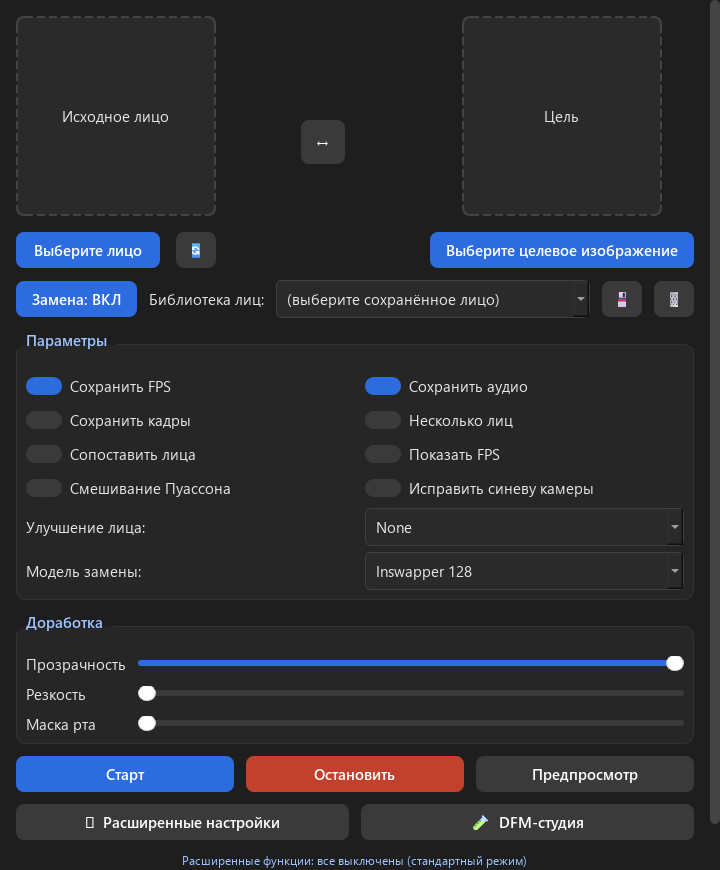
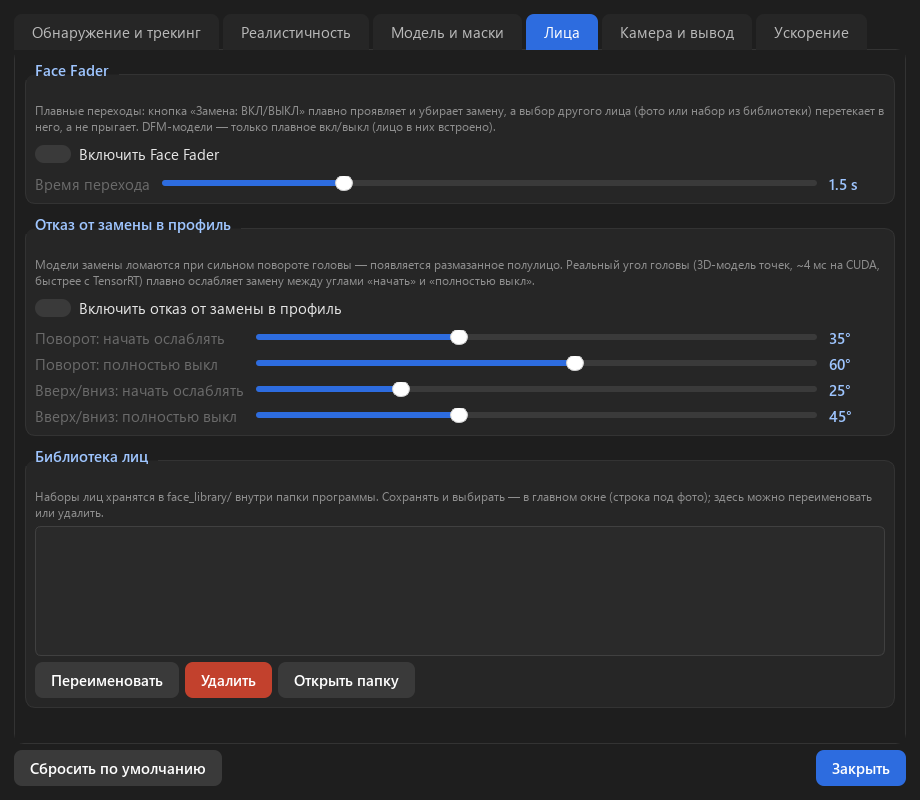
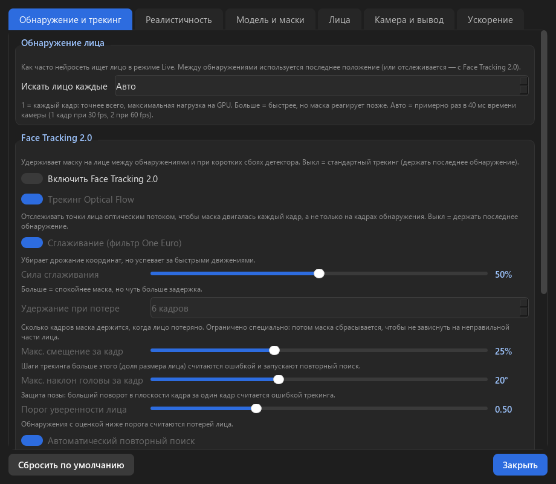
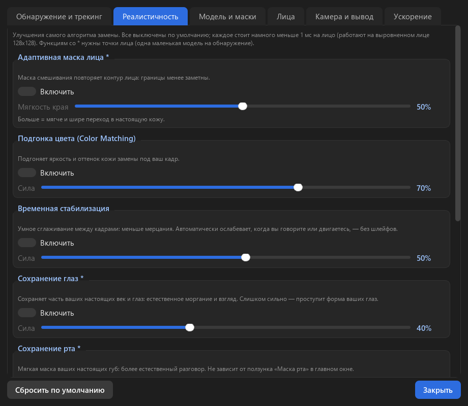
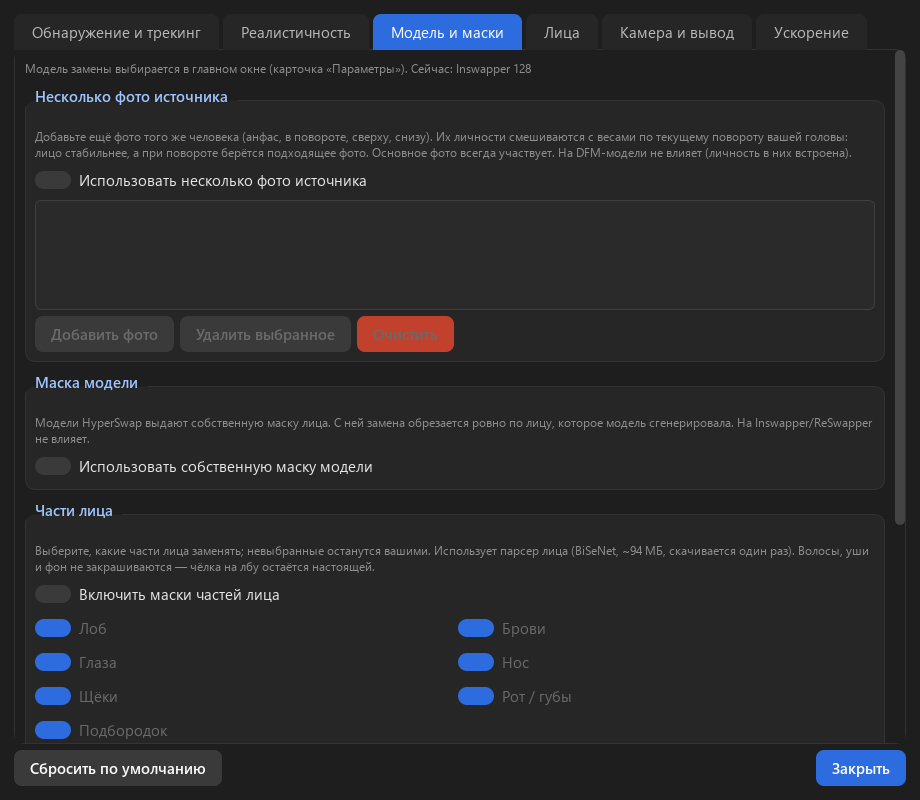
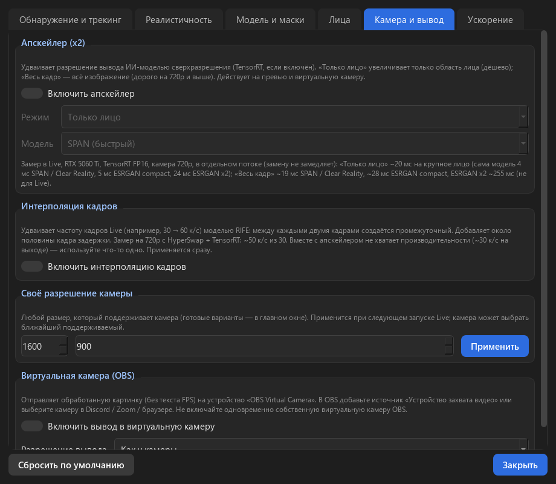
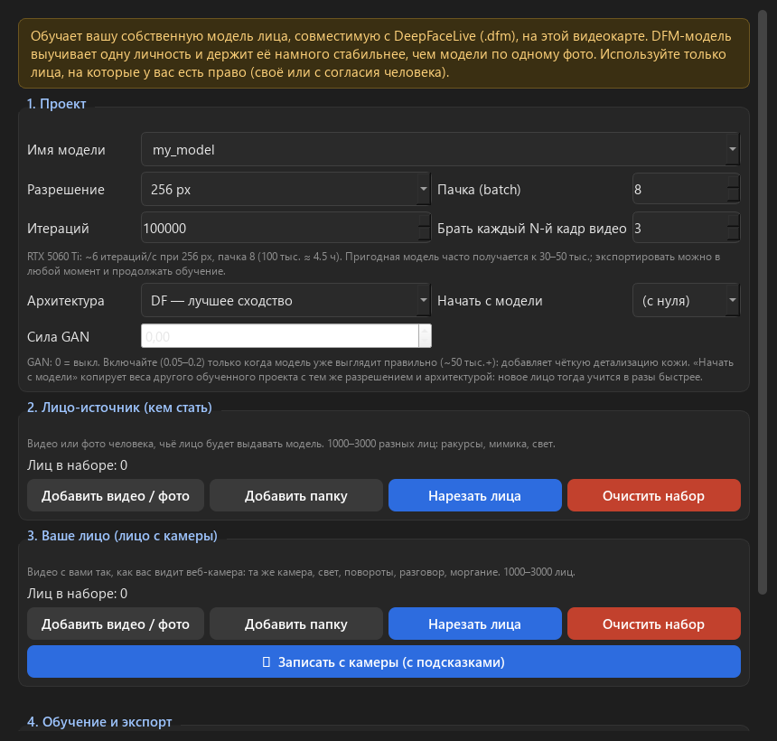

<h1 align="center">Deep-Boost-Cam</h1>

  <b>Ускоренная и прокачанная версия <a href="https://github.com/hacksider/Deep-Live-Cam">Deep-Live-Cam</a> для видеокарт NVIDIA</b> 
  TensorRT · Face Tracking 2.0 · HyperSwap 256 · свои DFM-модели · виртуальная камера для OBS · установка в один клик

  
  
  
  
  

  
  

> ⚠️ **Только NVIDIA.** Нужна видеокарта NVIDIA GeForce GTX 16xx / RTX 20xx или новее (лучше всего RTX 30/40/50) и свежий драйвер (**570+**). На AMD, Intel и Mac эта сборка не рассчитана — используйте [оригинал](https://github.com/hacksider/Deep-Live-Cam).

---

## 🚀 Установка (3 шага)

1. **Скачайте** проект: зелёная кнопка **Code → Download ZIP** и распакуйте в папку без лишних сложностей в пути (например `D:\Deep-Boost-Cam`). Или `git clone https://github.com/Demosand/Deep-Boost-Cam.git`.
2. **Запустите `installer\Install.bat`** (двойной клик). Установщик сам:
   - проверит видеокарту и драйвер;
   - найдёт или предложит установить **Python 3.11** (через winget);
   - создаст отдельное окружение `.venv` **внутри папки программы**;
   - поставит все библиотеки точно тех версий, что проверены (PyTorch CUDA 12.8, ONNX Runtime GPU 1.26, готовый insightface — компилятор не нужен);
   - установит и настроит **TensorRT 10.13** (подобран под ONNX Runtime 1.26 — не «последний», а совместимый);
   - скачает модели (рекомендуемые ~1.8 ГБ или все ~4.5 ГБ);
   - подстроит настройки под объём видеопамяти (на 8 ГБ — экономнее);
   - проверит, что CUDA и TensorRT реально работают, и создаст ярлык на рабочем столе.
3. **Запустите `Start-DeepBoostCam.bat`** (или ярлык «Deep-Boost-Cam»).

Первая загрузка — около 6–8 ГБ. Установщик можно запускать повторно: он доставит только недостающее (так же — после обновления программы).

> 💡 Всё (модели, кэши, временные файлы, движки TensorRT) хранится **только внутри папки программы** — ничего не разбрасывается по системе. Удалить программу = удалить папку.

### Обновления
При запуске программа сама проверяет, вышла ли новая версия на GitHub, и предлагает **«Установить»** — откроется страница релиза. Скачайте новую версию поверх старой и снова запустите `installer\Install.bat`. Проверку можно отключить: *Расширенные настройки → Ускорение → Обновления*.

---

## ✨ Чем отличается от оригинального Deep-Live-Cam

| | Deep-Live-Cam (оригинал) | **Deep-Boost-Cam** |
|---|---|---|
| Установка | вручную: Python, pip, CUDA-библиотеки, сборка insightface | **один bat-файл**, всё в папке программы |
| Ускорение | CUDA | **TensorRT FP16/FP32** (точность подобрана для каждой модели), сборка движков заранее |
| Модели замены | inswapper 128 | inswapper 128, **HyperSwap 1A/1B/1C 256**, **ReSwapper 256**, **свои DFM** |
| Свои модели лица | нет | **DFM-студия**: обучение своей модели на вашей видеокарте (DF / LIAE, GAN, запись с камеры) |
| Трекинг | детекция через кадр | **Face Tracking 2.0**: optical flow, сглаживание, удержание с автосбросом |
| Задержка | обработка = показ | **репроекция**: лицо следует за головой с частотой камеры даже при тяжёлой обработке |
| Реалистичность | базовая | адаптивная маска, подгонка цвета, стабилизация, сохранение глаз/рта, **зерно и резкость под камеру** |
| Маски | рот | **части лица** (лоб, брови, глаза, нос, щёки, рот, подбородок), **окклюзии** (руки, микрофон) |
| Переходы | нет | **Face Fader**: плавное вкл/выкл и «перетекание» в другое лицо, **библиотека лиц** |
| Повороты головы | артефакты | **плавный отказ от замены в профиль** по реальному углу головы |
| Вывод | окно | **виртуальная камера OBS**, апскейлер ×2 (лицо / кадр), **интерполяция 30→60 к/с** |
| Интерфейс | одно окно | окно **расширенных настроек** (6 вкладок), полностью на русском |

**Все новые функции по умолчанию выключены** — программа сначала работает как оригинал, а вы включаете нужное в *⚙ Расширенные настройки*.

  
  
  
  

---

## ⚡ Скорость (RTX 5060 Ti 16 ГБ, камера 720p)

| Что | CUDA | TensorRT |
|---|---|---|
| Детекция лица | 6.2 мс | **1.95 мс** |
| Замена Inswapper 128 | 15.5 мс | **8.4 мс** |
| Замена HyperSwap 256 | 12 мс | **8.3 мс** |
| Улучшение GPEN-256 | 10 мс | **4.8 мс** |
| Окклюзии (XSeg) | 7.3 мс | **3.9 мс** |
| HyperSwap + GPEN-256 на экране | 15 к/с | **24 к/с**, с репроекцией **29 к/с** |

При первом использовании каждой модели TensorRT собирает «движок» (0.5–4 мин, один раз). Чтобы не ждать во время эфира: *Ускорение → Собрать движки сейчас*.

### Видеокарты с 8 ГБ памяти
Работает. Рекомендуется: **HyperSwap 1B или Inswapper + GPEN-256**, TensorRT включён. GFPGAN и ReSwapper 256 тяжёлые; апскейлер и интерполяцию лучше не включать одновременно. В DFM-студии — batch 4–6. Установщик сам уменьшает память под сборку движков TensorRT.

---

## 🎥 Как пользоваться

1. **Выберите лицо** (фото человека) — или лицо из **библиотеки**, или DFM-модель в «Модель замены».
2. Выберите камеру и нажмите **«В реальном времени»**.
3. Для эфира/созвона: включите **«Виртуальная камера (OBS)»** и выберите камеру *OBS Virtual Camera* в Discord / Zoom / браузере / OBS (нужен установленный [OBS Studio](https://obsproject.com/)).
4. Тонкая настройка — *⚙ Расширенные настройки*; у каждой опции есть пояснение.

### DFM-студия — своя модель лица
DeepFaceLab не работает на RTX 50 (Blackwell), поэтому обучение переписано на PyTorch. Добавьте видео человека и запишите себя прямо с камеры (с подсказками) → «Нарезать лица» → «Начать обучение» → «Экспорт .dfm». Готовые модели DeepFaceLive (`.dfm`) тоже подходят — положите их в `models\dfm`.

---

## 🛠 Если что-то не так

| Проблема | Решение |
|---|---|
| «Не найден драйвер NVIDIA» | Установите свежий драйвер с nvidia.com |
| CUDA «не работает» в проверке | Обновите драйвер до 570+ и перезапустите установщик |
| Первый запуск Live «завис» | Идёт сборка движка TensorRT (до нескольких минут), это один раз |
| Нет «OBS Virtual Camera» | Установите OBS Studio; не включайте одновременно виртуальную камеру внутри OBS |
| Видео-режим не сохраняет файл | Нужен ffmpeg: `winget install Gyan.FFmpeg` (Live работает без него) |
| После обновления драйвера стало медленнее | *Ускорение → Очистить кэш движков* |

---

## ⚖️ Ответственное использование

Программа для творчества, контента и экспериментов **с вашим собственным лицом или с согласия человека**. Не выдавайте себя за реальных людей без их согласия, не используйте для обмана, мошенничества и материалов без согласия. Соблюдайте законы своей страны. Модели распространяются по своим лицензиям, многие — **только для некоммерческого исследовательского использования** (в т.ч. insightface).

## 🙏 Благодарности и лицензии

- [hacksider/Deep-Live-Cam](https://github.com/hacksider/Deep-Live-Cam) — основа проекта (AGPL-3.0). Оригинальный README: [docs/README-Deep-Live-Cam.md](docs/README-Deep-Live-Cam.md)
- [deepinsight/insightface](https://github.com/deepinsight/insightface) — анализ лица и inswapper (некоммерческое использование)
- [FaceFusion assets](https://github.com/facefusion/facefusion-assets) — HyperSwap, XSeg, BiSeNet, SPAN, Real-ESRGAN
- [somanchiu/ReSwapper](https://github.com/somanchiu/ReSwapper) (AGPL-3.0), [Practical-RIFE](https://github.com/hzwer/Practical-RIFE) (MIT), Real-ESRGAN (BSD-3)
- [beekamai/DeepLiveCam](https://github.com/beekamai/DeepLiveCam) (AGPL-3.0) — идеи для TensorRT, XSeg и HyperSwap
- Архитектура DFM — по мотивам DeepFaceLab / DeepFaceLive (iperov)

Лицензия проекта: **AGPL-3.0** (как у оригинала).
